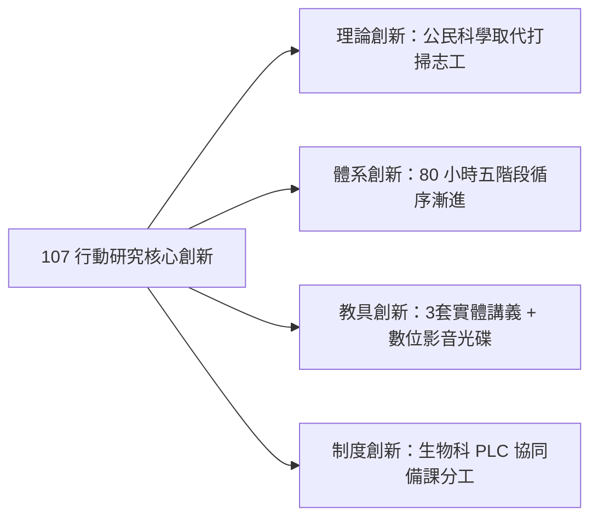

# 紀實：107 學年度・行動研究特優與模組化確立 (Action Research & Modularization)

## 1. 年度背景與核心突破
- **學術賽事**：臺北市第 19 屆中小學及幼兒園教育專業創新與行動研究。
- **獲獎榮譽**：
  1. **高中組・教育專業經驗分享類**：《培訓高中學生擔任生態保育研究志工 建立服務學習新方向》（林獻升、郭瓊華、蕭國偉）—— **榮獲特優**。
  2. **高中組・教材教具實物展示類**：《12年國教彈性學習課程推廣教材 公民科學家培訓課程模組》（林獻升、郭瓊華、蕭國偉）—— **榮獲特優/入選決審**。
- **年度里程碑**：
  - 本年度是麗山生物營隊實踐成果獲得**官方最高學術榮譽肯定**之歷史轉折點。
  - 確立了「3 套實體教材 + 1 套數位教學光碟」的標準化推廣模組，為即將到來的 108 課綱做好了全部的教材與師資準備。

---

## 2. 行動研究成果的核心創新提煉

### (1) 教育專業經驗分享類之洞見
- 論文直指 12 年國教採計超額比序「服務學習時數」所引發的國高中生搶當志工、浮濫蓋章現象。
- 提出以「公民科學（Citizen Science）」為槓桿，讓學生從「被動湊時數」轉變為「肩負科學家研究助理與生態守護者之神聖責任」，為全國中等學校服務學習樹立全新典範。

### (2) 教材教具實物展示類之完備性
- 開發完整 7 大主題講義、補充講義、授課指引與 106 營隊完整教學影像光碟，讓任何高中即便沒有帶隊經驗的生物老師，也能「打開教材盒即可開課」。

---

## 3. 校內課綱轉化落實
- 在麗山高中 107 學年度高一選課手冊中，正式列入「彈性學習選修課程——公民科學家培訓課程」，在校內進行試選試教，順利完成課綱銜接的前置驗證。

---

## 關聯頁面
- [[行動研究經驗轉化與課綱銜接]]
- [[七大模組化教學課程體系]]
- [[五階段長程培訓架構]]
- 原始文件：[[SRC_行動研究_培訓高中學生擔任生態保育研究志工]]、[[SRC_行動研究_彈性學習公民科學家課程模組教具說明]]
