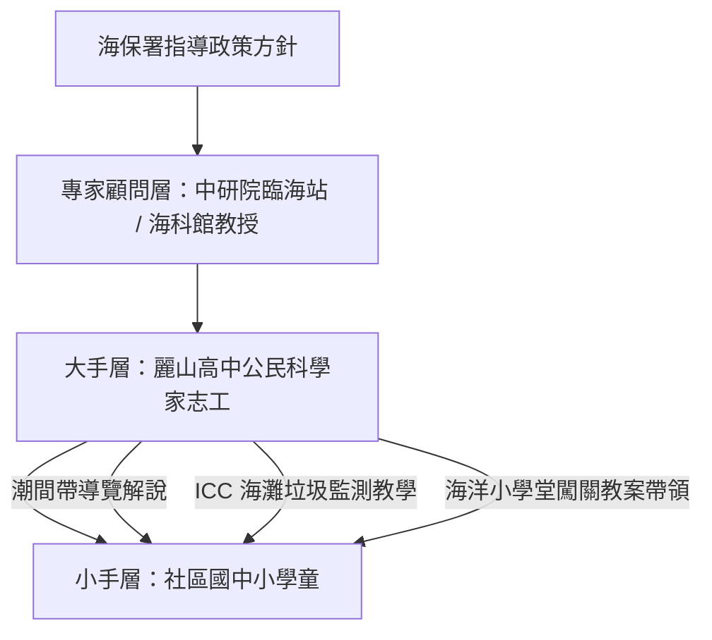

# 紀實：111 學年度・大手牽小手與海洋保育巡查 (Ocean Conservation Patrol Era)

## 1. 年度背景與核心突破
- **專案依據**：海洋委員會海洋保育署（海保署）指導、「海洋保育巡查員大手牽小手實施計畫」。
- **核定日期**：民國 111 年 4 月 22 日（世界地球日）。
- **年度里程碑**：
  - 麗山高中生物營隊與公民科學家體系，正式**對接國家級海洋保育治理政策**。
  - 首創「大學/研究單位 ➔ 高中種子解說員 ➔ 國中小學童」之三層垂直跨階共學模式（大手牽小手），將十餘年累積之海洋潮間帶解說經驗向下扎根。

---

## 2. 核心實施亮點與行動

### (1) 海洋保育巡查員專業培訓
- 麗山高中學生接受海保署巡查員之田野實務指導，學習辨識瀕危海洋物種（如海龜、鯨豚擱淺通報 SOP）、認識海洋保護區法規。

### (2) 國際淨灘行動 (ICC) 數據科學回報
- 帶領學童在東北角海灘進行標準化垃圾分類計數，將數據上傳至海保署「海洋廢棄物治理平台」，實踐真正的數據驅動公民科學。

### (3) 「大手牽小手」現場情意感染
- 高中生牽著國小學童的手漫步潮間帶，教導小朋友輕柔撫摸海膽與陽燧足，並宣導「不抓生物回家」的保育倫理，展現極高層次的環境教育社會責任。

---

## 3. 歷史總結：十載春秋的卓越昇華
從 101 學年度金面山下的青澀試探，到 111 學年度肩負國家海洋保育重任，麗山高中生物營隊體系已然成為臺灣中等教育最具影響力之生態與公民科學實踐傳奇。

---

## 關聯頁面
- [[公民科學家理念與核心素養]]
- [[場域_東北角馬岡海蝕平台]]
- [[場域_基隆國立海洋科技博物館與潮境公園]]
- 原始文件：[[SRC_111年度海洋保育巡查員大手牽小手計畫]]
