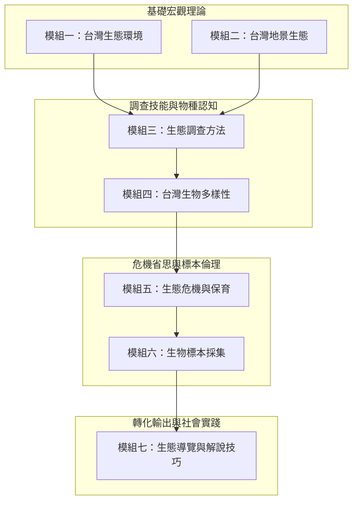

# 七大模組化教學課程體系 (Seven Modular Curriculum Framework)

麗山高中生物科歷經多年滾動修正，將龐雜的生態學、分類學、環境科學與解說實務，提煉並結構化為**七大核心教學模組**。本模組可靈活拆解為「2日密集營隊」、「學期18週彈性學習選修」或「高中專題研究先導課程」。

---

## 模組一：台灣生態環境 (Taiwan Ecological Environments)
- **目標**：理解造就臺灣高生物多樣性的立體垂直壓縮氣候帶與水平環境差異。
- **核心內容**：
  1. 臺灣氣候特徵（季風、洋流、地形雨、颱風干擾）。
  2. 垂直植被帶分布：高山寒原、針葉林帶（冷杉、鐵杉）、暖溫帶霧林帶（扁柏、紅檜）、亞熱帶常綠闊葉林（楠儲林帶）、熱帶季風林。
  3. 水域生態系統：高山溪流、湖泊濕地、河口紅樹林、岩礁與沙岸潮間帶。
- **實察映射**：[[場域_太平山與翠峰湖高海拔霧林帶]]、[[場域_東北角馬岡海蝕平台]]。

## 模組二：台灣地景生態 (Taiwan Landscape Ecology)
- **目標**：掌握地形地貌對生物棲地分佈的決定性影響，體認「地質是生態的舞台」。
- **核心內容**：
  1. 板塊擠壓與造山運動：造就臺灣高聳中央山脈與島嶼地形隔離演化。
  2. 火山地質景觀：大屯火山群安山岩、老梅風稜石、硫磺溫泉微棲地。
  3. 海岸侵蝕地貌：海蝕平台、海蝕洞（石門洞）、壺穴、豆腐岩與沉積砂岩構造。
- **實察映射**：[[場域_北海岸石門老梅與麟山鼻]]、[[場域_麗山生態池與金面山森林保護區]]。

## 模組三：生態調查方法 (Ecological Survey Methodologies)
- **目標**：習得客觀、定量、可重複之標準生態調查工具與方法。
- **核心內容**：
  1. 調查工具操作：GPS 座標定位、溫濕度計、水質測試筆（pH/溶氧/導電度）、風速計、照度計、雙筒與單筒望遠鏡。
  2. 樣區採樣技術：樣線法（Line Transect）、方樣法（Quadrat Method）、陷阱調查法（Pitfall Trap）、燈誘採樣。
  3. 數據登錄規範：田野筆記標準欄位、物種標記再捕計算法、資料去識別化與合規上傳。
- **實作活動**：校園生態系穿越線調查實作。

## 模組四：台灣生物多樣性 (Taiwan Biodiversity)
- **目標**：建立各類動植物門類的分類學辨識架構，認識臺灣特有種與特有亞種。
- **核心內容**：
  1. 植物界：蕨類、裸子植物、雙子葉被子植物與單子葉植物檢索。
  2. 無脊椎動物：潮間帶棘皮動物（海膽、海星、陽燧足）、軟體動物（貝類、海兔、頭足類）、節肢動物（昆蟲、螃蟹）。
  3. 脊椎動物：兩棲類（台北樹蛙、拉都希氏赤蛙）、爬行類、鳥類（常見 50 種留鳥與度冬候鳥）、哺乳類。
- **影音輔助**：高畫質顯微攝影觀察（草履蟲、渦蟲、水蚤、花粉管萌發）。

## 模組五：生態危機與保育 (Ecological Crisis & Conservation)
- **目標**：直面當前全球與在地環境浩劫，建立環境倫理與批判性思維。
- **核心內容**：
  1. 棲地破碎化與道路致死（路殺現象）。
  2. 外來入侵種衝擊：綠鬣蜥、小花蔓澤蘭、吳郭魚、巴西龜、琵琶鼠魚對本土物種之排擠。
  3. 海洋環境浩劫：微塑膠、廢棄漁網（幽靈漁具）、海洋酸化與珊瑚白化。
  4. 法律法規：野生動物保育法、環境教育法、海洋保育法規。

## 模組六：生物標本採集與製作 (Specimen Collection & Ethics)
- **目標**：學習科學標本保存之古典技藝，並建立嚴謹的「現代採集倫理」。
- **核心內容**：
  1. 採集倫理：不採保育類、不過量採集、非必要不捕殺、優先使用攝影與數位存證。
  2. 植物標本：吸水紙壓製法、烘乾定型、臘葉標本台紙縫合與標準名籤填寫。
  3. 特色工藝：葉脈標本透明書籤製作、幾丁質昆蟲針插標本整姿。
- **關聯文檔**：[[高中專題研究與野外採集倫理]]。

## 模組七：生態導覽與解說技巧 (Eco-guiding & Interpretation)
- **目標**：打破傳統單向講課，將科學語言轉譯為大眾聽得懂、感受得到的解說藝術。
- **核心內容**：
  1. 解說四大黃金原則（TORA 原則）：Theme（主題明確）、Organized（結構嚴整）、Relevant（引起共鳴）、Enjoyable（生動有趣）。
  2. 身體語言與隊形控制：扇形站位、光線逆光考量、音量穿透與眼神接觸。
  3. 生態遊戲設計：將食物鏈、棲地競爭、偽裝保護色融入互動遊戲（如「搶救棲地」、「蛇形刁手」）。
- **實地考核**：基隆海科館、潮境公園、校園開放日實地站點解說。

---

## 關聯頁面
- [[五階段長程培訓架構]]
- [[自然生態導覽與解說藝術]]
- [[生態遊戲教案設計方法]]
- [[高中專題研究與野外採集倫理]]
- 原始文件：[[SRC_教學課程_七大主題講義全集]]
