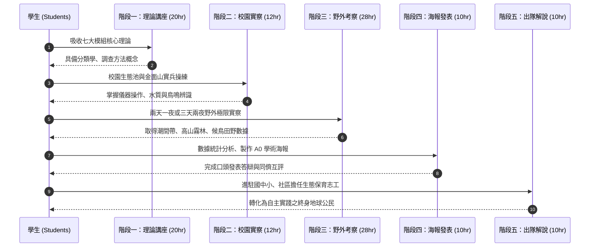

# 五階段長程培訓架構 (Five-Stage Long-term Training Model)

麗山高中生物科開創之「公民科學家與保育解說員培育模式」，突破傳統 1~2 天走馬看花式的營隊短效，建立總計 **80 小時、跨越全學年、循序漸進的五階段培訓體系**。

---

## 階段一：基礎理論與室內講座 (20 小時)
- **執行時間**：學期初（通常為上學期 10~12 月週末密集研討講座）。
- **教學場域**：麗山高中多功能大講堂、生物實驗室。
- **培訓主軸**：
  - 講授 [[七大模組化教學課程體系]] 之前五個主題（生態環境、地景生態、調查工具、多樣性、保育危機）。
  - 生態調查工具實體觸碰與校正訓練。
  - 口語解說技巧與 TORA 導覽原則入門。
- **檢核成果**：基礎生物學知識前測、工具操作分組過關考核。

## 階段二：校園生態與金面山實察 (12 小時)
- **執行時間**：學期中（週六上午或連續週末）。
- **教學場域**：麗山高中校園生態池、中庭水生植物區、金面山地質森林步道。
- **培訓主軸**：
  - **水域生態實操**：生態池水樣採集、水溫、pH、溶氧量、水生昆蟲與浮游生物顯微檢驗。
  - **陸域生態實操**：金面山沉積砂岩剪刀石地形考察、森林垂直層次調查、鳥類鳴叫定位紀錄。
- **檢核成果**：校園生物圖鑑查對紀錄單、小組樣線調查原始紀錄表。

## 階段三：野外多日生態考察營隊 (28 小時)
- **執行時間**：下學期春季（4~5 月）或暑期初（6~7 月），通常安排 2 天 1 夜高密度野外實察。
- **教學場域**：跨縣市多樣化生態系串聯。
  - **北海岸/東北角線**：石門老梅綠石槽、馬岡海蝕平台潮間帶、基隆海科館潮境海灣。
  - **宜蘭水鳥/高山線**：塭底時潮濕地、雙連埤、中研院臨海站、太平山翠峰湖霧林帶。
- **培訓主軸**：
  - 配合潮汐乾潮時刻進行潮間帶無脊椎動物與海藻實地調查。
  - 阿里磅生態農場或高山步道夜間生態觀察（夜觀蛙類、昆蟲燈誘、爬蟲類探索）。
  - 面對真實大自然不可預測性之應變與團隊求生互助。
- **檢核成果**：完整的野外實察筆記卡、標本照片紀錄、實地定點 3 分鐘解說錄影。

## 階段四：小組專題整合與學術海報發表 (10 小時)
- **執行時間**：營隊結束後 1~2 週內。
- **教學場域**：麗山高中專題研究教室、演講廳。
- **培訓主軸**：
  - 小組數據匯整、統計圖表繪製、生物照片精選與物種再次查核。
  - 製作標準 **A0 直式學術海報**（研究動機、實察地點與方法、結果分析、討論與反思）。
  - 辦理「生態考察成果發表會」，每組進行 5~8 分鐘口頭簡報並接受教師與同儕提問答辯。
- **檢核成果**：[[SOP_小組成果發表會與學術海報製作規範]]、小組海報輸出實體、同儕互評成績。

## 階段五：實地服務解說與社群推廣 (10 小時)
- **執行時間**：學期末、校慶日或暑假服務學習營隊。
- **教學場域**：國中小校園、社區活動中心、基隆海科館、麗山校慶生態嘉年華。
- **培訓主軸**：
  - 組成「自然生態解說志工團」。
  - 自主設計生態闖關攤位、觸摸觀察箱、互動式生態遊戲教案（如「搶救棲地」）。
  - 面對國小學童與一般社區民眾進行生動導覽與環境保護倡議。
- **檢核成果**：服務學習證明書核發、受服務學童回饋問卷、學生自我反思日誌。

---

## 關聯頁面
- [[公民科學家理念與核心素養]]
- [[七大模組化教學課程體系]]
- [[SOP_野外實察營隊籌辦全流程]]
- [[SOP_小組成果發表會與學術海報製作規範]]
- 原始文件：[[SRC_行動研究_培訓高中學生擔任生態保育研究志工]]
