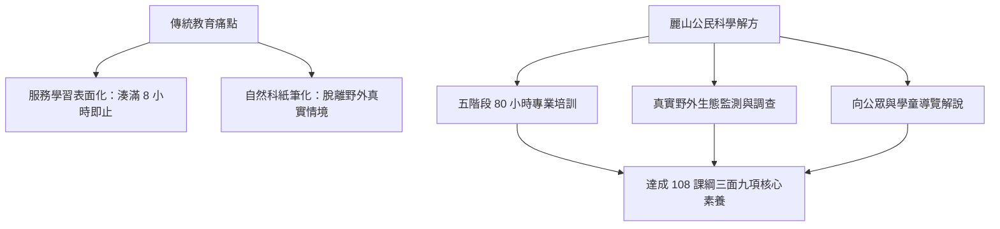

# 公民科學家理念與核心素養 (Citizen Scientist & Core Competencies)

## 1. 核心理念淵源

「公民科學（Citizen Science）」指一般公眾與專業科學家協同合作，參與真實科學研究過程（如收集數據、環境監測、生物物種調查與資訊標註）。此概念自 1990 年代起在國際科學界逐漸興起，隨著網路科技與智慧載具普及，已成為當代生物多樣性監測與氣候變遷因應的關鍵支柱（林瑞興，2016）。

麗山高中生物科教學團隊觀察到，臺灣中等教育長期存在「服務學習淪為表面積點（掃地、排書、撿垃圾）」以及「自然科學教育偏向紙筆背誦」之雙重弊端。為此，團隊開創性地將**公民科學理念**引入高中校園，建立「高中生擔任生態保育研究志工」之嶄新典範。

---

## 2. 108 課綱三面九項素養之具體映射

麗山生物營隊與公民科學家體系並非傳統的才藝營，而是高度對齊臺灣 12 年國教總綱核心素養之精準育才系統：

### 自主行動 (Self-directed Action)
- **A1 身心素質與自我精進**：野外長途實察與潮間帶探勘，鍛鍊學生堅韌之體能、耐挫力與田野專注力。
- **A2 系統思考與解決問題**：面對多變的戶外天候與複雜生態現象，學生學會運用科學方法設定樣區、排除變因並分析生態數據。
- **A3 規劃執行與創新應變**：主動規劃調查期程、分配組員任務並自主設計解說動線。

### 溝通互動 (Communication & Interaction)
- **B1 符號運用與溝通表達**：將繁複的野外調查原始數據轉換為專業的 A0 學術海報、圖表，並具備面對不同群眾之口語轉譯能力。
- **B2 科技資訊與媒體素養**：熟練操作 GPS 定位儀、單筒/雙筒望遠鏡、數位解剖顯微鏡、iNaturalist 與 eBird 等現代公民科學數位工具。
- **B3 藝術涵養與美感素養**：透過生態攝影、自然筆記描繪、葉脈標本製作，體會大自然演化構造的對稱與和諧之美。

### 社會參與 (Social Participation)
- **C1 道德實踐與公民意識**：恪守田野倫理，實踐「不破壞棲地、不濫採生命」之環境保護道德準則。
- **C2 人際關係與團隊合作**：四至六人小組在野外相互照應、安全警戒，分工合作完成長程探究任務。
- **C3 多元文化與國際理解**：理解全球氣候變遷與第六次大滅絕危機，立足臺灣本土生物多樣性，承擔「地球公民」之全球責任。

---

## 3. 從「學員」到「公民志工」的三層蛻變路徑

1. **第一層：自然觀察者（初階）**：學會使用五感（眼看、耳聽、手觸、鼻聞）觀察動植物，克服對泥土與昆蟲之排斥。
2. **第二層：科學調查員（進階）**：熟練標準化穿越線、樣方法，能夠辨識台灣常見 50 種以上鳥類、海藻與潮間帶無脊椎動物，產出合規數據。
3. **第三層：倡議解說員（高階）**：具備轉譯科學知識給公眾與學童的解說能力，走出校園進行環境保育行動。

---

## 4. 關聯主題與導航
- [[七大模組化教學課程體系]]
- [[五階段長程培訓架構]]
- [[自然生態導覽與解說藝術]]
- [[行動研究經驗轉化與課綱銜接]]
- 原始文件：[[SRC_行動研究_培訓高中學生擔任生態保育研究志工]]
