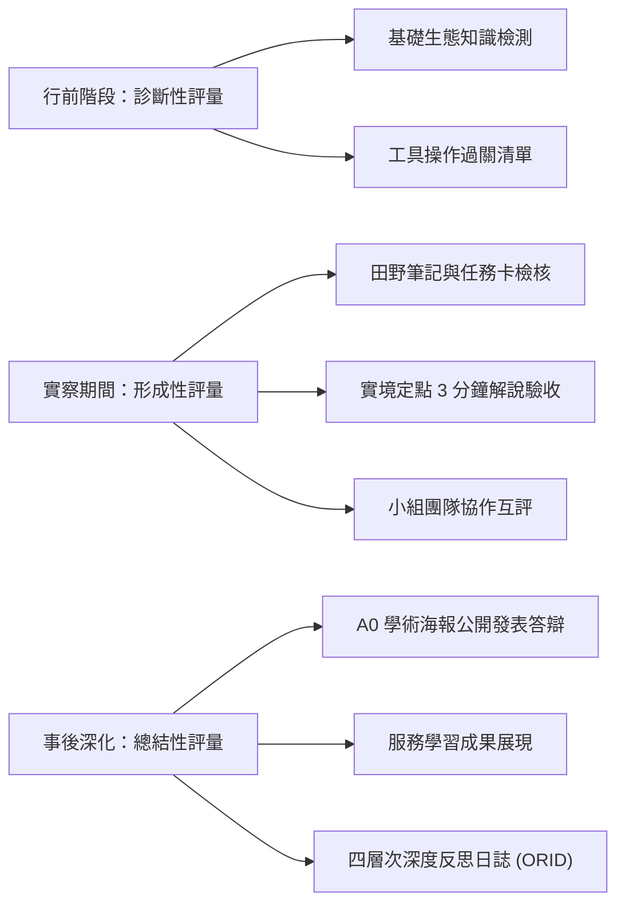

# 多元評量與反思機制 (Authentic Assessment & Reflection Framework)

## 1. 突破紙筆測驗的真實評量 (Authentic Assessment)
傳統高中生物教學多依賴選擇題、填空題等標準化紙筆測驗，難以客觀衡量學生在「野外實務操作、面對未知情境之解決能力、口語轉譯解說能力及環境倫理情意」。

麗山高中生物營隊建構了涵蓋**「診斷性、形成性與總結性」**之全歷程多元評量網絡，落實 108 課綱「質性向度、歷程導向、反思深化」之核心精神。

---

## 2. 評量工具與規準 (Rubrics)

### (1) 田野任務卡與實察筆記評量（佔比 25%）
- **客觀指標**：
  - 物種特徵描繪精確度（外形比例、顏色細節、特化構造）。
  - 生態數據紀錄之完整度（GPS 經緯度、時間、微棲地溫濕度、光照、底質類型）。
  - 樣線穿越調查法計算之規範性。

### (2) 實地定點口語解說演練評量（佔比 25%）
由教師與隨隊助教依據四大構面逐項評分（各佔 25 分）：
- **內容專業度**：科學概念正確無誤、無過度擬人化或偽科學。
- **主題聚焦性**：符合 TORA 原則，有鮮明的靈魂核心句。
- **表達感染力**：音量穿透、眼神接觸、肢體動作自然、善用比喻。
- **現場掌控力**：學員互動熱烈、時間掌握精準（3~5 分鐘）、突發狀況應對得體。

### (3) A0 學術海報公開發表會（佔比 30%）
- **視覺排版**：圖文比例適當（圖片 40%、文字 40%、圖表 20%）、色調和諧、字體大小在 1.5 公尺外清晰可辨。
- **科學邏輯**：研究動機清晰、方法具備可重複性、結果與討論呼應。
- **口頭答辯**：面對評審教師與同儕提問能冷靜梳理邏輯，坦誠說明研究限制。

### (4) 課後深度反思日誌與問卷（佔比 20%）
導入 **ORID 焦點討論法 (Objective, Reflective, Interpretive, Decisional)** 引導學生反思：
- **O (客觀事實)**：在這次實察中，你觀察到哪三種印象最深刻的生物？具體特徵為何？
- **R (情感感受)**：站在馬岡海蝕平台或翠峰湖濃霧中時，內心最直接的震撼是什麼？
- **I (意義詮釋)**：這次的解說演練，如何改變了你對自己溝通表達能力的認知？
- **D (未來行動)**：身為麗山公民科學家，回到校園或日常生活中，你將採取什麼具體行動保護環境？

---

## 3. 學習成效轉化為大學多元表現 (OPQN)
本套評量產出可無縫轉換為學生升學之優勢資產：
- **課程學習成果 (N/F 代碼)**：經教師認證之 A0 學術海報 PDF、野外實察完整探究報告書。
- **多元表現 (F 代碼 - 志工服務 / F 代碼 - 自主學習)**：80 小時專業公民科學培訓證書、解說志工證明、生態遊戲教案。
- **學習歷程自述 (OPQ 代碼)**：在自傳與個人陳述中，引用 ORID 反思歷程展現堅定之科學志向與社會公民責任意識。

---

## 關聯頁面
- [[自然生態導覽與解說藝術]]
- [[SOP_小組成果發表會與學術海報製作規範]]
- [[五階段長程培訓架構]]
- 原始文件：[[SRC_課後問卷與學生反思彙編]]
