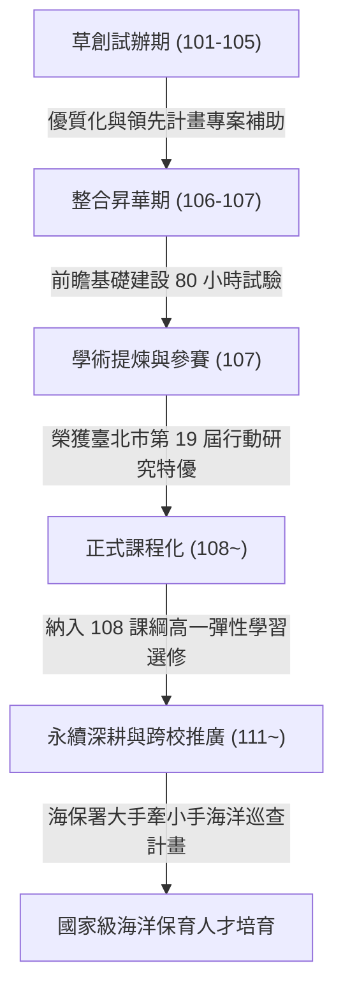

# 行動研究經驗轉化與課綱銜接 (Action Research & Curriculum Transformation)

## 1. 從「假日課外營隊」到「正式彈性學習選修」的跨越
麗山高中生物營隊的發展歷程，不僅是一部學生野外探究史，更是臺灣中等教育史上極具代表性的**「校本課程演進與行動研究典範」**。

在 101 至 106 學年度期間，營隊主要以教育部專案（高中優質化、領先計畫、前瞻基礎建設計畫）為經費來源，由 5 位生物專任教師犧牲週末假日，帶領選修生物專題或對生態有興趣的學生進行試辦。隨著累積案例與教案漸趨成熟，教師團隊透過「行動研究（Action Research）」將實務反思昇華為學術論文與推廣教具，最終成功在 108 課綱正式實施時，將其固化為麗山高中高一全校性的**「彈性學習時間選修課程——公民科學家課程模組」**。

---

## 2. 第 19 屆行動研究獲獎核心要件拆解

麗山高中生物科在臺北市第 19 屆教育專業創新與行動研究中一舉奪下雙項大獎，其獲獎之結構性優勢具備四大向度：

### (1) 痛點切中時代政策盲區
- 精準指陳 12 年國教採計志工比序導致的「服務學習形式化」弊病。
- 提供可複製、可量化、兼具專業學術深度的「公民科學家長程培育」實踐模型。

### (2) 教師專業學習社群 (PLC) 的真正實踐
- 拒絕單打獨鬥：由 5 位生物教師依各自專長（鳥類、昆蟲、解說、課程開發）組成互補團隊。
- 共同備課、協同教學、分擔帶隊負荷，展現極高之團隊抗壓性與持續性。

### (3) 理論與教具實物之扎實雙軌產出
- **文字報告**：完整的質性訪談、量化滿意度問卷、教學實施日誌。
- **實體教具**：包含課程講義、補充講義、授課指引與高畫質多媒體教學光碟，達到「隨取即用」的推廣價值。

### (4) 與 108 課綱三大面向九大核心素養無縫嵌合
- 詳實對應總綱素養指標，為全臺灣普通高級中學落實「彈性學習時間」樹立標竿示範。

---

## 3. 經驗轉化為學校「優質學校評選」之對應矩陣

本知識庫所沉澱之野外實察與公民科學家資產，可直接轉化為臺北市或教育部**「優質學校（課程發展、教師教學、學生學習、資源統整）」**之單項或整體申請論述材料：

| 優質學校向度 | 麗山生物營隊轉化亮點 | 引用 Wiki 知識庫支撐筆記 |
| :--- | :--- | :--- |
| **課程發展向度** | 緊扣金面山生態特色，首創 80 小時五階段、七大模組化校本特色課程。 | [[七大模組化教學課程體系]] [[五階段長程培訓架構]] |
| **教師教學向度** | 生物科 PLC 跨領域協同備課，假日投入實地帶隊，產出行動研究雙特優。 | [[人物_麗山生物科教師教學社群]] [[SRC_行動研究_培訓高中學生擔任生態保育研究志工]] |
| **學生學習向度** | 學生五感探索，完成 A0 學術海報公開答辯，走出校園擔任公眾解說志工。 | [[自然生態導覽與解說藝術]] [[多元評量與反思機制]] |
| **資源統整向度** | 縱向串接中研院臨海站、基隆海科館、海保署、阿里磅農場與在地社區。 | [[場域_基隆國立海洋科技博物館與潮境公園]] [[機構_中研院臨海研究站]] |

---

## 關聯頁面
- [[公民科學家理念與核心素養]]
- [[七大模組化教學課程體系]]
- [[人物_麗山生物科教師教學社群]]
- [[紀實_107學年度_行動研究特優與模組化確立]]
- 原始文件：[[SRC_行動研究_培訓高中學生擔任生態保育研究志工]]、[[SRC_行動研究_彈性學習公民科學家課程模組教具說明]]
