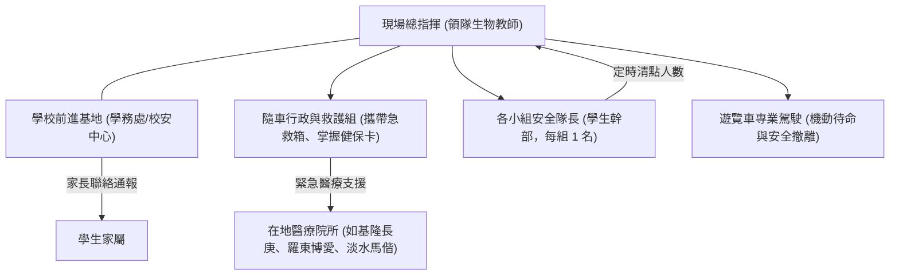

# 野外實察安全與風險管理 (Fieldwork Safety & Risk Management)

## 1. 戶外生態實察的零事故原則
戶外教學與野外實察充滿無可替代的感官震撼，但也伴隨著客觀田野環境的天然風險（大浪、溼滑礁石、高海拔低溫、落石、虎頭蜂、毒蛇與雷雨）。

麗山高中生物科秉持**「安全是所有教育探究的底線」**，歷經多年帶隊實踐，建立起一套橫跨「行前預防、現場監控、突發應變」的三維風險防護網，確保十餘年來數千人次野外實察保持**「零重大安全事故」**之卓越紀錄。

---

## 2. 三大典型實察場域之核心風險與防護矩陣

| 實察場域類型 | 主要客觀風險 | 預防規範與必備裝備 | 現場應變標準處置 |
| :--- | :--- | :--- | :--- |
| **潮間帶與海岸** (馬岡、老梅、麟山鼻) | • 濕滑海藻滑倒 • 突發性瘋狗浪 • 海膽刺傷/芋螺毒性 • 漲潮受困外礁 | • 一律穿著**防滑釘鞋或包趾橡膠防滑鞋**（嚴禁夾腳拖與涼鞋） • 嚴格遵守**退潮前 1.5hr 進入、乾潮後 1hr 撤離** • 設立隨隊安全觀察員（專人面向外海監控浪況） | • 刺傷立即使用生理食鹽水沖洗並檢視有無斷刺 • 發現異常巨浪立即吹哨，全體向內陸高處撤退 |
| **高海拔森林與步道** (太平山、翠峰湖) | • 驟降低溫與失溫 • 濃霧迷途 • 溼滑木棧道/泥濘 • 高山症反應 (AMS) | • **洋蔥式穿著法**（排汗內層+保暖中層+防風防水外層） • 攜帶高熱量行動糧與保溫水瓶 • 全隊嚴格維持「隊首教師領航、隊尾安全員殿後」，嚴禁單獨脫隊 | • 出現頭痛、嘔吐等高山症跡象立即停止上升，原處休息並安排逐步下撤 • 起濃霧時縮小隊伍間距，彼此保持目視與口語聯繫 |
| **低海拔次生林與夜觀** (阿里磅、金面山) | • 蜂螫（黑腹虎頭蜂、黃腳虎頭蜂） • 蛇咬（赤尾青竹絲、雨傘節、龜殼花） • 黑暗跌倒與蚊蟲叮咬 | • **長袖長褲、帽子、高筒雨鞋或厚襪登山鞋** • 嚴禁噴灑濃郁香水或穿著鮮豔黑色衣物 • 夜觀必備個人手電筒（頭燈佳），隨行攜帶長柄手杖「打草驚蛇」 | • 遭遇蜂類盤旋：**壓低身體、護住頭部、安靜直線倒退離開**，絕不可揮手拍打！ • 疑似蛇咬：記住蛇類特徵（不抓蛇）、脫去戒指飾品、傷口低於心臟、彈性繃帶壓迫包紮，撥打 119 送醫 |

---

## 3. 雙層留守與指揮通報體系

野外實察期間建立清晰扁平之應變指揮鏈：

---

## 關聯頁面
- [[SOP_野外實察野外急救與安全防護SOP]]
- [[SOP_大客車租賃安全檢核與乘車管理]]
- [[場域_東北角馬岡海蝕平台]]
- [[場域_太平山與翠峰湖高海拔霧林帶]]
- 原始文件：[[SRC_活動手冊歷屆全景彙編]]
