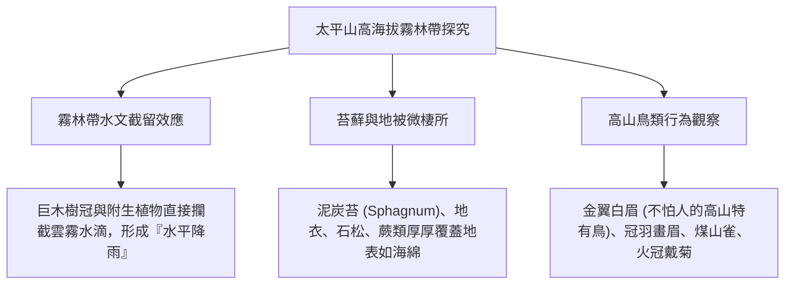

# 場域：太平山與翠峰湖高海拔霧林帶 (Taipingshan & Cueifong Lake Cloud Forest)

## 1. 地理氣候與生態地位
- **地理位置**：宜蘭縣大同鄉與南澳鄉交界，海拔自 500 公尺一路攀升至 2,000 公尺以上（翠峰湖海拔約 1,840 公尺，為臺灣最大的高山天然高山湖泊）。
- **盛行雲霧帶 (Cloud Forest / Mist Forest)**：終年受東北季風與太平洋水氣迎風抬升影響，年平均相對濕度高達 85% 以上，午後經常大霧瀰漫，雨量豐沛（年降雨量破 4,000 毫米）。
- **林相分界**：為暖溫帶與涼溫帶之天然過渡區，保存世界級的**臺灣扁柏（Chamaecyparis obtusa var. formosana）與紅檜（Chamaecyparis formosensis）巨木林**。

---

## 2. 實察教學重點與高海拔生態現象

### (1) 翠峰湖環山步道之泥炭苔與靜謐之聲
- **冰河孓遺景觀**：翠峰湖形成於更新世晚期，周邊低窪潮濕處覆蓋厚實的**泥炭苔（Sphagnum cymbifolium）**。泥炭苔細胞具有極強吸水能力（可吸收自體重量 20 倍以上水分），宛如天然蓄水海綿。
- **世界級沉靜步道**：翠峰湖東側被認證為臺灣首條「寂靜山徑」，環境背景噪音低於 25 分貝。教師帶領學生進行「5 分鐘閉眼靜心傾聽」，訓練學生的聲景（Soundscape）聽覺敏銳度。

### (2) 見晴懷古步道之伐木歷史與生態復育
- 舊時運材軌道與檜木巨木遺跡，引導學生思考臺灣林業政策演進（從日治時期與戰後的檜木伐採，到 1989 年全面禁伐天然林）。
- 觀察二代木（倒伏巨木上生長出新樹苗的世代交替）與樹抱石現象。

### (3) 高海拔防寒防滑與高山症防範
- 海拔每上升 1,000 公尺氣溫下降約 6°C，太平山頂氣溫常較平地低 10~15°C。
- 嚴格落實 [[野外實察安全與風險管理]] 之洋蔥式穿衣原則與步道慢行規定。

---

## 關聯頁面
- [[七大模組化教學課程體系]]
- [[野外實察安全與風險管理]]
- [[場域_宜蘭雙連埤與福山植物園]]
- 原始文件：[[SRC_野外實察課程全紀錄_102-108]]
