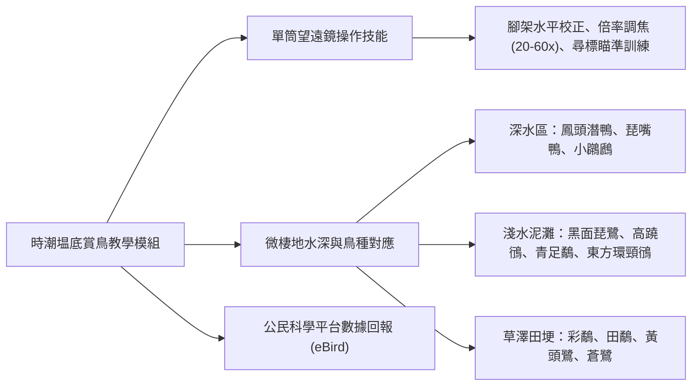

# 場域：宜蘭時潮塭底與蘭陽溪口濕地 (Yilan Birdwatching Wetland)

## 1. 地理水文與候鳥驛站地位
- **地理範圍**：宜蘭縣礁溪鄉時潮村、壯圍鄉塭底、五結鄉蘭陽溪河口水鳥保護區。
- **生態成因**：蘭陽溪、冬山河與宜蘭河三江匯流注入太平洋，沖積出廣袤低平的感潮泥灘地、水田、草澤與鹹淡水養殖魚塭。
- **東亞-澳洲候鳥遷徙線 (EAAF)**：地處國際東亞水鳥遷徙必經的中途「補給加油站」，每年 10 月至翌年 4 月，數以萬計的雁鴨科、鷸鴴科、鷺科候鳥在此度冬停歇。

---

## 2. 實察教學重點與觀鳥技能

### (1) 鳥類辨識形態學要點
- **喙部特化 (Bill Morphology)**：
  - 琵嘴鴨之匙狀喙（濾食浮游生物）。
  - 反嘴鴴向上微翹之細長喙（在泥水表面左右橫掃掃食小型甲殼類）。
  - 黑面琵鷺之長扁扁湯匙狀喙（觸碰感應水中魚蝦）。
- **足部與適應**：
  - 水鴨之蹼足（游水前進）。
  - 鷺鷥科、高蹺鴴之細長涉水腿（在軟泥中行走不陷落）。

### (2) 單筒望遠鏡架設與隊形實戰
- 每組配發 1 支專業高倍率單筒望遠鏡（Kowa / Nikon 20~60x）與鋁合金油壓腳架。
- 學生輪流擔任「尋標員」與「解說員」：一人負責在數百公尺外的泥灘精準捕捉焦點，另一人透過目鏡向組員解說該鳥種之羽色、覓食動作與飛行特徵。

### (3) 人與環境的共生智慧
- 引導學生考察在地養殖漁業（如九孔、蝦池、鹹水吳郭魚）與水鳥的食物鏈互動，探討「友善養殖、收成後放乾池底曬池供水鳥覓食」之共榮生態模式。

---

## 關聯頁面
- [[七大模組化教學課程體系]]
- [[公民科學家理念與核心素養]]
- [[場域_宜蘭雙連埤與福山植物園]]
- 原始文件：[[SRC_野外實察課程全紀錄_102-108]]
