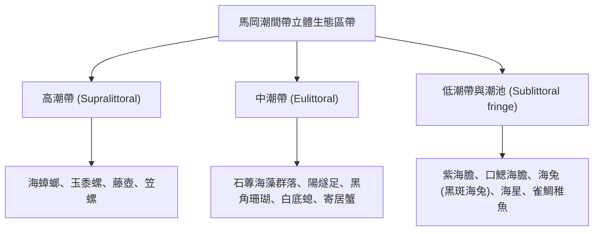

# 場域：東北角馬岡海蝕平台 (Magang Intertidal Flat)

## 1. 地理位置與地質特徵
- **地理坐標**：新北市貢寮區馬岡漁港旁（臺灣本島極東點三貂角燈塔正下方）。
- **地形地質**：極為發達之**海蝕平台（Wave-cut Platform）**，寬達上百公尺，由沉積岩中的厚層砂岩與頁岩互層構成。長年受強烈東北季風浪蝕作用，形成縱橫交錯的節理、海蝕溝、潮池（Tide Pools）與浪蝕凹壁。
- **水文環境**：直接面臨太平洋開闊洋面與黑潮支流，水質清澈、溶氧充足，為臺灣北部海洋生物多樣性最繁茂的潮間帶之一。

---

## 2. 實察教學重點與特色物種

### (1) 海藻群落季相演替
- **春季（3~5 月）**：海蝕平台上鋪滿鮮綠色的**石蓴（Ulva lactuca）**與扁石蓴，宛如「綠色地毯」，為植食性螺類與海兔提供龐大食物來源。
- **夏季**：大型藻類受高溫曝曬枯萎，微細底棲矽藻與紅藻接替。

### (2) 指標動物群落
- **棘皮動物門**：陽燧足（如長腕蛇尾）、紫海膽（Anthocidaris crassispina）、口鰓海膽、海星。學生可觀察海膽利用管足與棘刺移動、攝食海藻之形態特徵。
- **軟體動物門**：海兔（海蛞蝓）、笠螺、鐘螺、寶螺、蜑螺、章魚。
- **節肢動物門甲殼亞門**：白底螅、相手蟹、方蟹、藤壺、寄居蟹。

---

## 3. 田野調查關鍵安全與踩線 SOP
1. **潮汐黃金窗口**：出隊前必須查閱中央氣象署「福隆/貢寮潮汐預報」，**必須鎖定大潮期間的乾潮時刻**。全隊應於乾潮前 1.5 小時抵達著裝下海，乾潮後 1 小時內全體吹哨上岸。
2. **必備防護裝備**：
   - 一律穿著**防滑釘鞋或厚底毛氈菜瓜布底防滑鞋**（岩石覆蓋海藻極度溼滑）。
   - 配戴棉紗手套，防止礁石割傷或被海膽刺傷。
3. **環境守則**：恪守 [[高中專題研究與野外採集倫理]]，翻動石頭檢視完畢必須翻回原位，活體觀察 10 分鐘內放回原潮池。

---

## 關聯頁面
- [[七大模組化教學課程體系]]
- [[高中專題研究與野外採集倫理]]
- [[野外實察安全與風險管理]]
- [[紀實_104學年度_跨校聯合與解說培訓期]]
- 原始文件：[[SRC_野外實察課程全紀錄_102-108]]
