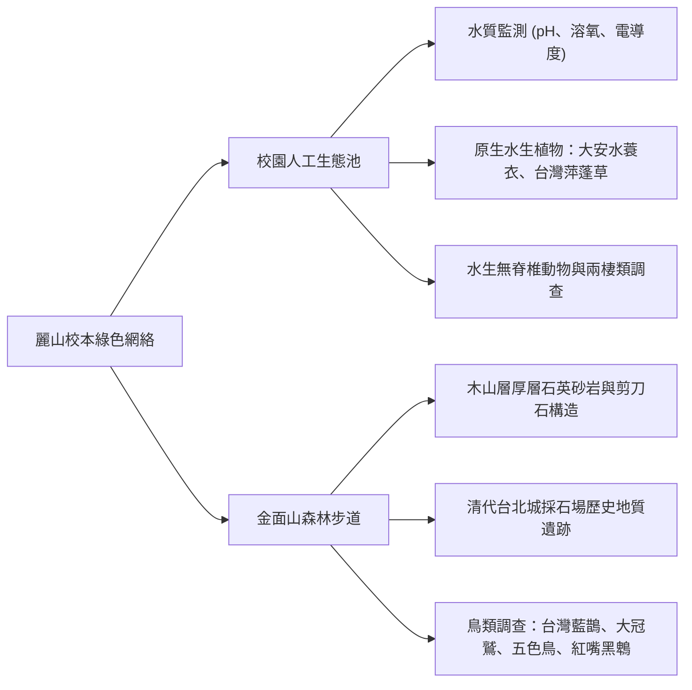

# 場域：麗山生態池與金面山森林保護區 (LSSH Campus Eco-pond & Jinmianshan)

## 1. 校本地理優勢與環境脈絡
- **地理坐標**：臺北市內湖區環山路二段，背倚五指山系南稜金面山（海拔 258 公尺）。
- **校園心臟**：麗山高中為全臺灣首所以「科學教育為發展重點」的高級中學。學校於建校之初即規劃佔地寬廣的**校園人工生態池**，結合水流循環、沉水植物、浮水植物與挺水植物，營造出完整的濕地微生態圈。
- **後山天然實驗室**：校園後方即為金面山森林保護區步道入口，師生走出校門步行 3 分鐘即可踏入茂密的亞熱帶常綠闊葉林，為全臺都會區高中少見的頂級生態教學場域。

---

## 2. 實察教學重點與校本探究課題

### (1) 麗山生態池之微生態學探究
- **水質長期監測點**：每屆營隊與專題學生在此進行定點水質取樣，長期比對季節降雨、日照對水質理化因子之影響。
- **微棲地多樣性**：
  - 挺水區：水燭、野慈菇、野薑花。
  - 浮水區：滿江紅、水萍、布袋蓮（用於解說外來種入侵）。
  - 沉水區：苦草、水蘊草。
- **指標動物觀察**：貢德氏赤蛙、黑眶蟾蜍、紅娘華、水螳螂、蜻蜓稚蟲（水蠆）。

### (2) 金面山之沉積地質與森林多樣性
- **木山層石英砂岩**：沉積於漸新世至中新世，砂岩質地堅硬、富含石英顆粒，在陽光下閃閃發亮，故名「金面山」。
- **剪刀石巨岩地景**：頂峰巨岩受造山擠壓垂直隆起呈齒狀交錯，為探討「沉積岩節理與風化剝落」之絕佳實體教材。
- **清代採石場古蹟**：解說光緒年間興建台北府城城牆所開採安山岩與砂岩之歷史人文連結。
- **森林鳥類熱點**：為保育類臺灣藍鵲（Urocissa caerulea）家族固定築巢繁殖地，常可目擊大冠鷲在盤旋熱氣流上方鳴叫。

---

## 關聯頁面
- [[七大模組化教學課程體系]]
- [[五階段長程培訓架構]]
- [[公民科學家理念與核心素養]]
- 原始文件：[[SRC_野外實察課程全紀錄_102-108]]
