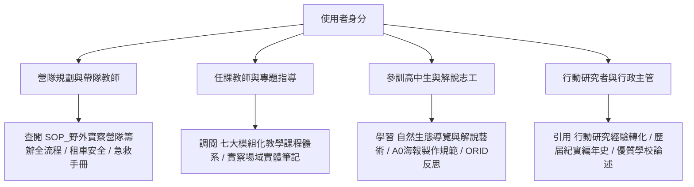

# 麗山高中生物營隊與公民科學家知識庫 全域主索引 (Knowledge Map)

歡迎查閱**臺北市立麗山高級中學 生物科**「生物營隊、野外實察與公民科學家課程」全域知識庫（LLM Wiki）。  
本知識庫嚴格遵循 **Andrej Karpathy LLM Wiki 典範**，沉澱麗山生物科自 101 至 111 學年度十餘年來深厚之野外實察傳統、教學講義、行動研究得獎論文、標準作業程序與行政法規智慧。

---

## 🌐 三位一體立體知識庫網絡通道 (Tri-Wiki Navigation)

> [!TIP]
> **已建立兩座垂直專屬子知識庫，與本母庫形成三位一體立體知識網絡**：
> 1. 🏫 **[公民科學培訓課程 課程子知識庫 (Curriculum Sub-Wiki)](file:///Users/froglssh/Library/CloudStorage/GoogleDrive-frog@lssh.tp.edu.tw/我的雲端硬碟/01專題教材/公民科學培訓課程/index.md)**：高二多元選修（10週）、高一彈性學習（18週）、麗山常態成績評量規準 (90分≤20%、85分≤50%)、學習歷程檔案 (OPQN)。
> 2. 🏆 **[公民科學家 課程發表與得獎子知識庫 (Awards Sub-Wiki)](file:///Users/froglssh/Library/CloudStorage/GoogleDrive-frog@lssh.tp.edu.tw/我的雲端硬碟/09課程發表/1公民科學家/index.md)**：天下文化「未來教育 臺灣100」得獎教案、全國 KDP 教學創新國際認證、臺北市行動研究雙特優、優質化嘉年華巨幅海報展與優質學校申辦論述。

---

## 🧭 多角色快速導航入口 (Role-based Portals)

- **【營隊籌辦與行政行政門戶】**：
  - 完整籌備流程：[[SOP_野外實察營隊籌辦全流程]]
  - 專案經費預算核銷：[[SOP_教育部專案計畫申請與經費核銷]]
  - 車輛租賃安全檢驗：[[SOP_大客車租賃安全檢核與乘車管理]]
  - 緊急醫療與突發狀況應變：[[SOP_野外實察野外急救與安全防護SOP]]
- **【教學設計與課程開發門戶】**：
  - 課程架構總覽：[[七大模組化教學課程體系]]
  - 長程培育體系：[[五階段長程培訓架構]]
  - 體驗式學習教案：[[生態遊戲教案設計方法]]
  - 田野道德準則：[[高中專題研究與野外採集倫理]]
- **【學生解說員與專題發表門戶】**：
  - 口語解說與 TORA 原則：[[自然生態導覽與解說藝術]]
  - 解說員實境考核規準：[[SOP_生態解說員實地演練與評量規準]]
  - 學術海報排版與發表會：[[SOP_小組成果發表會與學術海報製作規範]]
  - 深度反思日誌：[[多元評量與反思機制]]
- **【行動研究與校本品牌門戶】**：
  - 理念淵源與素養對齊：[[公民科學家理念與核心素養]]
  - 行動研究與課綱銜接：[[行動研究經驗轉化與課綱銜接]]
  - 歷屆歷史演進紀實：[[紀實_101-102學年度_種子萌芽期]] ~ [[紀實_111學年度_大手牽小手與海洋保育巡查]]

---

## 📚 核心知識目錄矩陣 (Wiki Directory Matrix)

### 一、核心概念與教學法 (Concepts)
| 頁面名稱 | 核心主題與提要 | 關鍵標籤 |
| :--- | :--- | :--- |
| [[公民科學家理念與核心素養]] | 公民科學定義、翻轉傳統打掃服務學習、108課綱三面九項素養映射 | 核心素養, 教育哲學 |
| [[七大模組化教學課程體系]] | 臺灣生態環境、地景生態、調查方法、多樣性、保育、標本採集、導覽解說 | 課程模組, 教學架構 |
| [[五階段長程培訓架構]] | 理論講座(20hr)、校園實察(12hr)、野外考察(28hr)、海報發表(10hr)、出隊解說(10hr) | 80小時體系, 培訓階段 |
| [[自然生態導覽與解說藝術]] | TORA原則（主題、架構、共鳴、生動）、扇形站位、戶外隊形掌控心法 | 解說藝術, 口語表達 |
| [[生態遊戲教案設計方法]] | 搶救棲地、蛇形刁手、草木皆兵、步步高昇、風水輪流轉、甲蟲教室 | 遊戲化學習, 體驗教案 |
| [[野外實察安全與風險管理]] | 潮間帶防浪防滑、高海拔防寒與高山症防範、蜂蛇避險、雙層指揮通報 | 安全防護, 風險管理 |
| [[高中專題研究與野外採集倫理]] | 數位照片存證優先、觀察後即刻釋回、翻石必歸位、LNT無痕山林 | 田野倫理, 科學道德 |
| [[多元評量與反思機制]] | 形成性與總結性評量、任務卡檢核、A0海報互評、ORID焦點討論反思 | 多元評量, 歷程檔案 |
| [[行動研究經驗轉化與課綱銜接]] | 臺北市第19屆行動研究雙特優成果、轉化為高一彈性學習選修與優質學校論述 | 行動研究, 課綱轉化 |

---

### 二、實察場域、機構與人物 (Entities)
| 頁面名稱 | 場域類型與重點特徵 | 代表物種與地質地景 |
| :--- | :--- | :--- |
| [[場域_東北角馬岡海蝕平台]] | 東北角廣袤海蝕平台、潮池微棲地、海洋生物多樣性 | 石蓴、紫海膽、陽燧足、黑斑海兔、海星 |
| [[場域_北海岸石門老梅與麟山鼻]] | 大屯火山安山岩熔岩岬角、極端東北季風風成地貌 | 老梅綠石槽、風稜石、風剪樹、定沙牆、石門海蝕拱門 |
| [[場域_阿里磅生態農場與八煙聚落]] | 低海拔次生林、環境信託生態池、兩棲蛙類夜觀聖地 | 台北樹蛙、拉都希氏赤蛙、水生昆蟲、里山地熱梯田 |
| [[場域_宜蘭時潮塭底與蘭陽溪口濕地]] | 東亞水鳥度冬核心驛站、感潮泥灘地、鹹淡水養殖魚塭 | 黑面琵鷺、反嘴鴴、高蹺鴴、度冬雁鴨、單筒望遠鏡操作 |
| [[場域_宜蘭雙連埤與福山植物園]] | 低海拔天然淡水湖泊、水社柳天然浮島、未受干擾闊葉林 | 蓴菜、水社柳、山羌、藍腹鷴、常綠闊葉林分層 |
| [[場域_太平山與翠峰湖高海拔霧林帶]] | 臺灣最大高山湖泊、暖溫涼溫過渡盛行雲霧帶、檜木巨木林 | 泥炭苔、臺灣扁柏、紅檜、金翼白眉、寂靜山徑 |
| [[場域_基隆國立海洋科技博物館與潮境公園]] | 垃圾掩埋場轉型海洋保育區、海洋教育與解說志工考核基地 | 潮境保育區、珊瑚斷枝復育、海馬繁養殖、海洋小學堂 |
| [[場域_麗山生態池與金面山森林保護區]] | 麗山校本綠色心臟、人工濕地循環、木山層石英砂岩地質 | 台灣萍蓬草、水質監測、剪刀石地景、清代採石場、台灣藍鵲 |
| [[機構_中研院臨海研究站]] | 國家級海洋生物發育與基因體學科研重鎮、科學家面對面 | 紫海膽人工受精胚胎、九孔品系選育、頭足類行為觀察 |
| [[人物_麗山生物科教師教學社群]] | 麗山高中生物科 PLC（林獻升、郭瓊華、蕭國偉、白瓊如等） | 協同備課、專長互補（鳥類/昆蟲/植物/解說）、全員帶隊 |

---

### 三、標準作業程序 (SOPs)
| 頁面名稱 | 適用情境與主要流程 | 核心檢核工具 |
| :--- | :--- | :--- |
| [[SOP_野外實察營隊籌辦全流程]] | T-60天行政立案至 T+14天結案核銷標準甘特圖與路線踩線準則 | 營隊全期甘特圖、潮汐窗口表 |
| [[SOP_教育部專案計畫申請與經費核銷]] | 高中優質化、領先計畫、前瞻建設、海保署經費科目標準與防退件要領 | 六大科目標準表、憑證黏貼規範 |
| [[SOP_大客車租賃安全檢核與乘車管理]] | 租車合約規範（車齡小於5年）、出車前 6 大必檢項目、長途駕駛工時控管 | 車輛安全檢驗表、逃生演練指引 |
| [[SOP_野外實察野外急救與安全防護SOP]] | 隨隊防水醫藥箱清單、蜂螫、蛇咬、潮間帶割傷、失溫緊急應變處置 | 急救處置流程圖、在地醫療院所名冊 |
| [[SOP_小組成果發表會與學術海報製作規範]] | A0 直式海報排版規範（圖45%、文40%）、發表會計時議程與模擬答辯題庫 | A0海報版型標準、答辯評分表 |
| [[SOP_生態解說員實地演練與評量規準]] | 走讀式定點輪動解說演練工作流、100分量化評量規準表（TORA/科學性/感染力） | 四構面評分表、自我覆盤表 |

---

## ⏳ 歷屆年表紀實 (Chronology)
1. [[紀實_101-102學年度_種子萌芽期]]：優質化 C1 計畫起步，金面山與東北角採集初步摸索。
2. [[紀實_103學年度_路線擴展與海報發表期]]：優質化 D-1-1 營隊，開闢基隆、宜蘭山區、時潮賞鳥、三峽四大路線，確立海報發表會。
3. [[紀實_104學年度_跨校聯合與解說培訓期]]：跨校聯合營隊、馬岡海蝕平台採集、宜蘭冬季營隊、小班口語解說演練。
4. [[紀實_105學年度_高海拔突破與領先計畫期]]：領先計畫支持，首度挺進太平山翠峰湖 2,000 公尺霧林帶，落實自主管理評核。
5. [[紀實_106學年度_前瞻整合與80小時完整體系]]：教育部前瞻基礎建設面向一，建立橫跨全年、四階段、80 小時全景培訓模式。
6. [[紀實_107學年度_行動研究特優與模組化確立]]：榮獲臺北市第 19 屆行動研究雙特優殊榮，出版公民科學家課程模組教材與教具。
7. [[紀實_108學年度_新課綱彈性學習與深耕]]：108 課綱正式落地，轉化為高一全校彈性學習選修，舉辦太平山三富、北海岸金山營隊。
8. [[紀實_111學年度_大手牽小手與海洋保育巡查]]：對接海保署專案，建立大學-高中-國中小三層垂直共學，培育國家級海洋巡查員。

---

## 🗄️ 原始文檔提煉筆記 (Sources)
- [[SRC_野外實察課程全紀錄_102-108]]：328 頁歷史全景簡報與文字紀錄提煉。
- [[SRC_行動研究_培訓高中學生擔任生態保育研究志工]]：第 19 屆行動研究經驗分享類特優全文提煉。
- [[SRC_行動研究_彈性學習公民科學家課程模組教具說明]]：第 19 屆行動研究教材教具實物展示類特優全文提煉。
- [[SRC_教學課程_七大主題講義全集]]：七大主題講義、補充講義與實驗觀察紀錄。
- [[SRC_活動手冊歷屆全景彙編]]：28 份歷屆活動手冊架構與學習單提煉。
- [[SRC_106年度前瞻計畫生物營隊心得報告]]：前瞻計畫 80 小時四大模組實施成果與質性心得。
- [[SRC_111年度海洋保育巡查員大手牽小手計畫]]：海保署大手牽小手計畫書與推廣架構。
- [[SRC_課後問卷與學生反思彙編]]：歷屆量化滿意度問卷統計與手寫質性反思彙編。

---

## ⚙️ 系統規範與工具 (Meta)
- 規範定義：[[wiki-rules]]
- 維護歷史日誌：[[log]]
- 智能助手定義：[[SKILL]]
