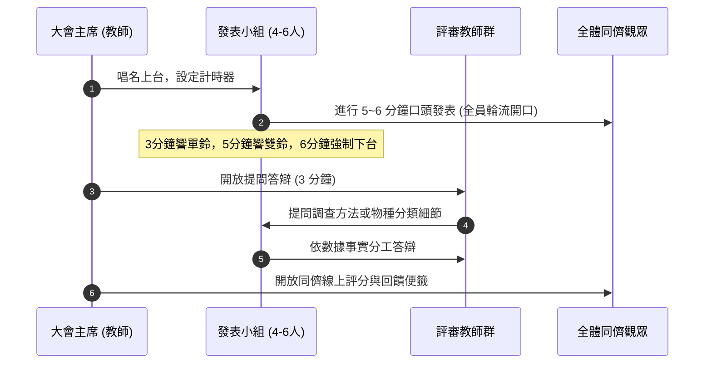

# SOP：小組成果發表會與學術海報製作規範 (Academic Poster & Presentation SOP)

麗山高中生物營隊的顯著特色在於**「堅持以專業學術會議（Academic Conference）之嚴謹規格，辦理小組公開發表會」**。營隊不以遊記心得為滿足，而是引導學生將實察數據萃取為標準 **A0 直式學術海報**，進行現場口頭發表與答辯。

---

## 1. A0 學術海報標準排版規範

```
┌────────────────────────────────────────────────────────┐
│           [題目] 繁體中文標題 (字體 60-72pt 粗體)        │
│    作者：小組成員姓名 (指導教師：林獻升、郭瓊華、蕭國偉)  │
├───────────────┬────────────────────────────────────────┤
│ 一、研究動機  │ 三、實察結果與數據分析                 │
│ 與背景說明    │ • 樣區穿越線物種豐富度柱狀圖           │
│ (24-28pt)     │ • 潮池水質理化因子對比折線圖           │
├───────────────┤ • 實地拍攝指標動植物高解析照片 (附圖說)│
│ 二、實察場域  ├────────────────────────────────────────┤
│ 與調查方法    │ 四、討論與棲地威脅分析                 │
│ • GPS 座標    │ • 物種適應特徵與環境因子之相關性       │
│ • 穿越線配置  │ • 外來種入侵或人為干擾之衝擊評估       │
│ • 工具使用    ├────────────────────────────────────────┤
│               │ 五、反思總結與公民守護行動建議         │
└───────────────┴────────────────────────────────────────┘
```

### (1) 尺寸與解析度
- **版面大小**：標準 **A0 直式 (841 mm × 1189 mm)**，設定 CMYK 印刷色彩模式。
- **解析度**：至少 200~300 DPI，防止大圖輸出模糊。

### (2) 圖文配比黃金法則
- **總比例**：圖片與資訊圖表 45%、文字說明 40%、留白 15%。
- **視覺動線**：由左至右、由上而下，欄位寬度均勻，避免長篇大論的段落（每段文字不超過 4 行，多使用條列點）。
- **字體規範**：中文字體優先使用思源黑體或標楷體，英文使用 Arial 或 Times New Roman；內文字級嚴禁小於 24pt（確保在 1.5 公尺外可清晰閱讀）。

---

## 2. 成果發表會標準議程與評量流暢度 (Presentation Protocol)

成果發表會通常於營隊返校後第 5 至 7 天，在麗山高中階梯大講堂或圖書館閱覽廳舉行：



### 評分比重矩陣
1. **海報專業度 (30%)**：排版美學、數據可信度、圖文對齊、無錯別字與學名格式正確（屬名大寫、種小名小寫斜體）。
2. **口頭表達力 (30%)**：台風穩健、眼神接觸、脫稿解說、時間掌握在 5 分 30 秒至 6 分整之內。
3. **學術答辯 (20%)**：邏輯條理、對自身數據盲點有自知之明、不盲目強辯。
4. **團隊協作度 (20%)**：全體組員均有實質發言分配，展現高度默契。

---

## 關聯頁面
- [[多元評量與反思機制]]
- [[五階段長程培訓架構]]
- [[自然生態導覽與解說藝術]]
- 原始文件：[[SRC_野外實察課程全紀錄_102-108]]
