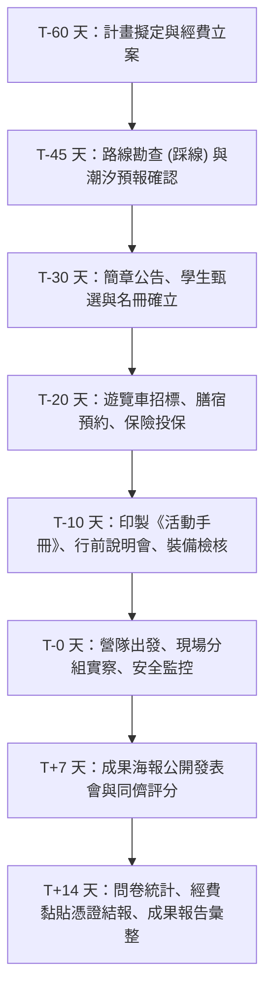

# SOP：野外實察營隊籌辦全流程 (Fieldwork Planning SOP)

本 SOP 總結麗山高中生物科十餘年野外實察籌辦經驗，為未來生物教師與行政人員提供「從 T-60 天行政立案到 T+14 天成果核銷」之標準全景工作流。

---

## 階段一：立案與規劃期 (T-60 ~ T-45 天)
1. **計畫立案**：撰寫實施計畫書（明列法規依據、活動宗旨、參加對象、預期效益與經費預算表），會辦教務處、學務處、總務處與主計室完成校內行政陳核。
2. **潮汐與天候窗口確認**：
   - 若包含潮間帶行程（如馬岡），**必須上中央氣象署網站查詢該月份農曆初一、十五前後之大潮乾潮時間**。
   - 乾潮時間落在上午 10:00~14:00 間為最佳出隊時段。
3. **場勘踩線 (Reconnaissance)**：核心教師親自走訪預定景點，確認：
   - 遊覽車大客車能否順利迴轉停靠。
   - 步道維修狀態、落石風險、公共洗手間水源與用餐容納量。
   - 行動電話通訊盲區與最近急救醫療院所動線。

---

## 階段二：招募甄選與行政發包 (T-30 ~ T-15 天)
1. **宣傳與甄選**：發布報名簡章，學生繳交報名表與家長同意書；若超額則依生物科在學成績、學習歷程表現或專題研究志願篩選。
2. **大客車租賃採購**：嚴格依循 [[SOP_大客車租賃安全檢核與乘車管理]]，會同總務處事務組完成合法乙類/甲類大客車招標。
3. **膳宿與場地預約**：確認餐廳合菜菜色（確認素食人數）、住宿房間配置表（男女分層分棟管制）。
4. **旅行平安保險**：送交全體師生、助教保險名冊，投保足額之「學校校外教學意外平安險暨傷害醫療險」。

---

## 階段三：整備與行前教育 (T-14 ~ T-1 天)
1. **編製與印製活動手冊**：依據 [[SRC_活動手冊歷屆全景彙編]] 之標準結構，排版印製教師版（彩色）與學生版手冊。
2. **辦理行前說明會 (Mandatory Briefing)**：
   - 召集全體錄取學生，說明行程時間軸、天氣預報、攜帶物品清單。
   - 鄭重宣導 [[野外實察安全與風險管理]] 與 [[高中專題研究與野外採集倫理]]。
   - 分配小組名冊，選出各組組長、器材員、安全員與紀錄員。
3. **公文請假與差假派代**：完成帶隊教師公差假手續與調課派代陳核，通報校安中心行程備查。

---

## 階段四：現場實施與機動監控 (T-0 ~ T+2 天)
1. **出發集合安全檢查**：檢查學生穿著（防滑鞋、長褲、帽子），發放小組公用器材（望遠鏡、水質包、急救包）。
2. **車輛安全檢驗**：帶隊教師逐項勾稽大客車行照、駕駛執照、酒測紀錄、輪胎胎紋與安全門開關。
3. **現場動態控管**：嚴格落實「隊首領隊、隊尾押隊」，定點解說計時，定時點名清點人數。

---

## 階段五：成效驗收與結案核銷 (T+3 ~ T+14 天)
1. **小組成果發表會**：營隊結束後一週內辦理 A0 學術海報公開口頭答辯（參照 [[SOP_小組成果發表會與學術海報製作規範]]）。
2. **問卷調查與統計**：發放並回收學生課後滿意度與學習效益問卷，輸入統計表產出雷達圖。
3. **經費核銷結案**：收集全數發票憑證、車資領據、工作費簽章，黏貼憑證後送主計室結報，並上傳完整成果報告至主管機關系統。

---

## 關聯頁面
- [[SOP_大客車租賃安全檢核與乘車管理]]
- [[SOP_教育部專案計畫申請與經費核銷]]
- [[SOP_小組成果發表會與學術海報製作規範]]
- [[野外實察安全與風險管理]]
