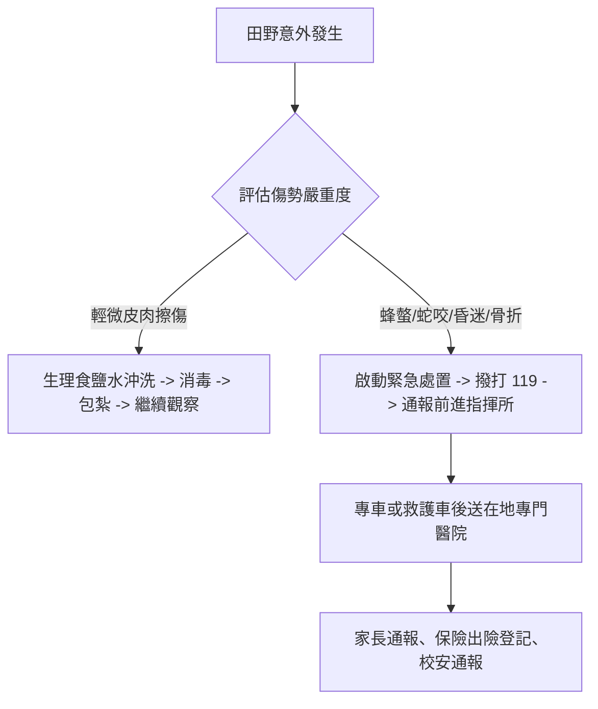

# SOP：野外實察野外急救與安全防護SOP (Field First Aid & Emergency Response SOP)

野外實察環境瞬息萬變，本 SOP 針對常見田野突發意外（蜂螫、蛇咬、潮間帶割刺傷、失溫、熱傷害、骨折扭傷）制定標準應變處置標準流程。

---

## 1. 隨隊野外急救醫藥箱標準配備清單

出隊前必須由隨隊救護人員或行政老師逐項盤點專用防水急救箱：
- **消毒與包紮器材**：無菌生理食鹽水 (500ml x 2)、優碘棉棒、75% 酒精棉片、無菌紗布墊 (4x4、3x3)、彈性繃帶、透氣膠帶、三角巾 (至少 3 條)、止血帶。
- **田野防護專用工具**：排毒拔罐器（蜂螫輔助）、細尖鑷子（夾除刺與木屑）、剪刀、安全別針、水銀/電子體溫計、冰敷袋與即時保冷劑、鋁箔防寒太空毯 (至少 4 件)。
- **常備外用藥劑**：蚊蟲叮咬止癢藥膏、燙傷藥膏、凡士林、白花油/薄荷棒。
- **全隊資料袋**：全體師生健保卡（實體集中保管於防水夾鏈袋中）、緊急聯絡電話名冊、個人重大病史與過敏紀錄表。

---

## 2. 六大田野突發狀況標準處置準則

### (1) 蜂類螫傷 (Bee/Wasp Sting)
1. **立即脫離現場**：蜂群有費洛蒙警戒標記，全隊立刻朝逆風方向、低姿態安靜撤離至少 50~100 公尺。
2. **剔除毒針**：若為蜜蜂螫傷，毒囊常留在皮膚表面，用硬卡片（健保卡邊緣）或鑷子「水平刮除」，**切忌用手指直接擠壓毒囊**，避免更多毒液注入體內。
3. **清洗與冷敷**：以大量清水沖洗，使用冰敷袋減緩腫脹與疼痛。
4. **過敏性休克警戒**：密切觀察患者有無全身蕁麻疹、呼吸困難、喉頭水腫、臉色蒼白或血壓驟降。若出現過敏休克徵兆，立即注射腎上腺素筆（若有配備）並火速送醫。

### (2) 疑似毒蛇咬傷 (Snakebite)
1. **保持鎮靜與傷肢制動**：安撫傷患嚴禁奔跑，使傷肢**保持低於心臟水平**，減緩血液毒素回流。
2. **摘除束縛物**：第一時間取下手錶、戒指、手鐲與緊身鞋襪，避免肢體腫脹壞死。
3. **記住毒蛇外觀**：記住蛇頭形狀、體色、斑紋（或用手機安全距離拍照），提供急診醫師辨識投予對應抗蛇毒血清。
4. **絕對嚴禁事項**：
   - **嚴禁用嘴吸吮毒液**。
   - **嚴禁用刀劃開傷口放血**。
   - **嚴禁用止血帶過度勒緊阻斷動脈血流**。
   - **嚴禁在傷口冰敷**。
5. **後送**：使用彈性繃帶以「彈性包紮法」由遠心端向近心端適度加壓包紮，立刻聯絡 119 送往備有血清之醫院。

### (3) 潮間帶礁石割傷與海膽刺傷
1. **海膽棘刺斷留**：不可強行盲目擠壓挑挖。以生理食鹽水沖洗，若棘刺深陷肉中，先消毒包紮，回程送醫由外科醫師在無菌條件下夾除。
2. **藤壺/礁石牡蠣割傷**：海洋弧菌風險極高。先以大量無菌生理食鹽水將傷口內砂粒雜物沖洗乾淨，塗抹抗生素藥膏並包紮。若 24 小時內傷口發紅發熱腫脹，必須立即就醫。

### (4) 高海拔失溫 (Hypothermia)
1. 立即將患者移入避風帳篷或遊覽車內。
2. 脫去潮濕衣物，換上乾燥衣物，包裹鋁箔防寒太空毯與睡袋。
3. 提供溫熱高糖飲料（如溫黑糖水），嚴禁給予咖啡因或酒精飲料；嚴禁直接浸泡熱水以免引起心室纖維顫動。

---

## 3. 實察主要場域在地緊急醫療院所聯絡網
- **東北角線（馬岡/福隆）**：基隆長庚紀念醫院 (02-2431-3131)、衛生福利部基隆醫院 (02-2429-2525)。
- **北海岸線（石門/金山）**：台大醫院金山分院 (02-2498-9898)、淡水馬偕紀念醫院 (02-2809-4121)。
- **宜蘭線（時潮/雙連埤/太平山）**：羅東博愛醫院 (03-954-3131)、國立陽明交通大學附設醫院 (宜蘭院區 03-932-5192)。

---

## 關聯頁面
- [[野外實察安全與風險管理]]
- [[SOP_野外實察營隊籌辦全流程]]
- [[場域_東北角馬岡海蝕平台]]
- [[場域_太平山與翠峰湖高海拔霧林帶]]
